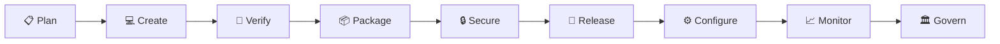

# 🚢 ShipShape AI

> **Release-Readiness Dashboard & DevSecOps Automation Workflow**  
> Built for the GitLab Transcend Hackathon: *"Life After Code: The Path to Production at the Speed of Imagination"*

---

## 🌟 Overview

**ShipShape AI** solves the post-commit blind spot in modern software delivery. While writing code is faster than ever with AI assistants, moving that code safely from commit to production remains plagued by fragmented pipelines, opaque security findings, disconnected compliance checks, and nervous manual approvals.

ShipShape AI provides a unified, intelligent single-pane-of-glass dashboard and pipeline automation suite that tracks changes through all nine post-code DevSecOps stages: **Plan, Create, Verify, Package, Secure, Release, Configure, Monitor, and Govern**.

---

## ✨ Key Features

- **🎯 Real-Time Release-Readiness Scoring (0–100)**: Deterministic algorithm evaluating test coverage, security severity findings, stage checks, and policy conformance.
- **🔄 Complete 9-Stage DevSecOps Lifecycle**: Visual progression across the entire GitLab lifecycle with status badges, detailed check items, and duration logs.
- **🛡️ Integrated Security & Vulnerability Intelligence**: Highlighting SAST, secret detection, container scan, and dependency vulnerability findings with severity ratings and one-click remediation guidance.
- **🚦 Production Approval Gate**: Strict manual promotion controls. Automated policy verification ensures mandatory checks and zero critical/high vulnerabilities prior to release.
- **🤖 GitLab Duo Integration**: Designed to integrate with GitLab Duo Code Review and custom automated release analysis workflows.
- **📊 Exportable Release & Policy Reports**: Machine-readable JSON and XML pipeline reports (`reports/release-report.json`, `reports/policy-report.json`, `reports/secret-scan.json`).
- **💡 Built-in Demo Mode**: Seamless toggle between live system data and curated sample scenarios demonstrating risk detection and release gating.

---

## 🏗️ Architecture & Tech Stack

- **Framework**: [Next.js 16](https://nextjs.org/) (App Router, React 19, TypeScript)
- **Styling**: [Tailwind CSS v4](https://tailwindcss.com/) with a sleek dark-mode glassmorphic design system
- **Icons**: Accessible unicode and inline SVGs for zero extra runtime overhead
- **Testing**: Jest 30 with `@testing-library/react` and `ts-jest`
- **Automation Scripts**: Native Node.js ESM scripts for secret scanning, release analysis, and policy enforcement
- **CI/CD**: GitLab CI pipeline (`.gitlab-ci.yml`) covering `verify`, `secure`, `package`, `release`, and `govern`

---

## 🚀 Quick Start

### Prerequisites

- Node.js 20+ (Node 24 supported)
- npm 10+

### Installation

```bash
# Clone the repository
git clone https://gitlab.com/your-username/shipshape-ai.git
cd shipshape-ai

# Install dependencies
npm install

# Copy environment configuration
cp .env.example .env.local
```

### Development Server

```bash
npm run dev
```

Visit [http://localhost:3000](http://localhost:3000) to view the ShipShape AI dashboard.

### Health Check Endpoint

```bash
curl http://localhost:3000/api/health
```

---

## 🧪 Available Scripts

| Script | Command | Purpose |
|---|---|---|
| **Development** | `npm run dev` | Starts Next.js development server |
| **Build** | `npm run build` | Compiles optimized production bundle |
| **Lint** | `npm run lint` | Runs ESLint checks |
| **Type Check** | `npm run type-check` | Validates TypeScript types (`tsc --noEmit`) |
| **Unit Tests** | `npm test` | Runs Jest unit test suites |
| **CI Tests** | `npm run test:ci` | Runs Jest with coverage and JSON/JUnit reporters |
| **Secret Scan** | `npm run secret-scan` | Scans workspace files for leaked keys and credentials |
| **Release Analysis** | `npm run release-analysis` | Evaluates pipeline artifacts and calculates readiness score |
| **Policy Check** | `npm run policy-check` | Validates release against promotion policies |
| **Full Suite** | `npm run checks` | Executes lint, type-check, tests, and secret scan in sequence |

---

## 📋 DevSecOps Lifecycle Stages



1. **Plan**: Requirements traceability and GitLab issue tracking.
2. **Create**: Source code branching, merge requests, and GitLab Duo Code Review.
3. **Verify**: Automated unit tests, integration tests, type checks, and linter rules.
4. **Package**: Production builds, container images, and deployment packaging.
5. **Secure**: Static analysis (SAST), dependency scanning, secret detection, container inspection.
6. **Release**: Release notes generation, semantic tagging, and staged deployment.
7. **Configure**: Infrastructure as Code validation, environment drift detection.
8. **Monitor**: Synthetic health checks, application telemetry, uptime monitoring.
9. **Govern**: Regulatory compliance, audit trails, and strict manual approval gates.

---

## 🔒 Security & Safe Operating Principles

- **Zero Auto-Deploy to Production**: Production promotion strictly requires manual human sign-off.
- **Deterministic Promotion Checks**: The readiness score calculator and `policy-check` script enforce zero open critical/high vulnerabilities and passing test suites.
- **No Hardcoded Credentials**: Automatic pre-commit and CI secret scanning blocks secrets from entering git history.

---

## 📄 License

This project is licensed under the MIT License — see the [LICENSE](LICENSE) file for details.
